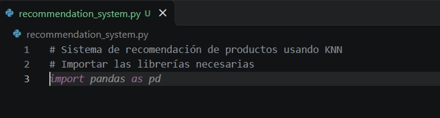
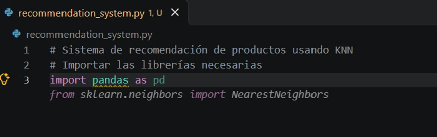
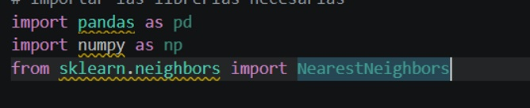
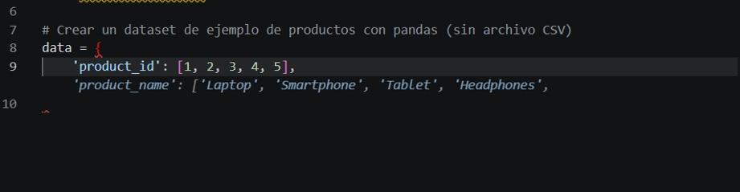
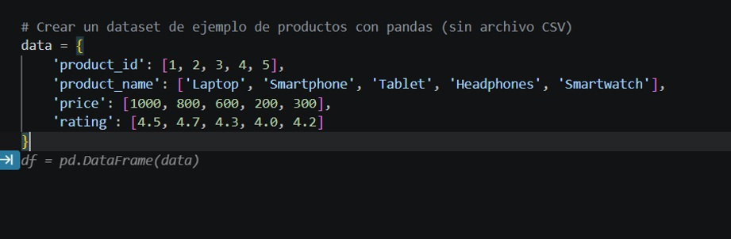
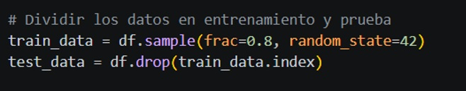
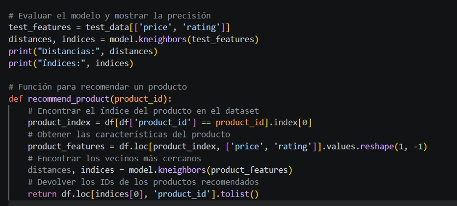
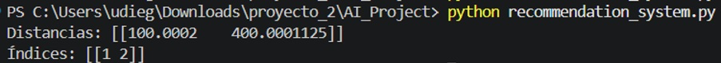

# AI_Project: Sistema de recomendación con GitHub Copilot

**Autor:** Diego Ignacio Ulloa Perez

**Asignatura:** Tendencias de Inteligencia Artificial Aplicada – Semana 8

**Institución:** INACAP

## 📌 Descripción

Este proyecto forma parte de la actividad formativa **"GitHub Copilot"**, cuyo objetivo es explorar las tendencias emergentes en inteligencia artificial usando GitHub Copilot como herramienta práctica.

Se desarrolló un **sistema de recomendación de productos** en Python basado en el algoritmo de **vecinos más cercanos** (`NearestNeighbors` de la librería *scikit-learn*). El código se generó con ayuda de GitHub Copilot.

## 🛠️ Herramientas utilizadas

- GitHub (repositorio y control de versiones)
- GitHub Copilot (asistente de programación con IA)
- Visual Studio Code
- Git
- Python 3 con las librerías `pandas`, `numpy` y `scikit-learn`

---

## 📋 Proceso paso a paso

### Paso 1: Crear la cuenta en GitHub
Ingresé a [github.com](https://github.com/), creé mi cuenta con mi correo electrónico y la validé con el código de verificación que me llegó.

### Paso 2: Activar GitHub Copilot (plan gratis)
En la sección de precios seleccioné el plan **Gratis** de GitHub Copilot.

### Paso 3: Crear el repositorio
Desde el Dashboard hice clic en **New** y creé el repositorio **`AI_Project`** como público, con un archivo README.

### Paso 4: Clonar el repositorio en mi computador
En el terminal de Visual Studio Code cloné el repositorio con:

```bash
git clone https://github.com/zaaaik/AI_Project.git
cd AI_Project
```

### Paso 5: Crear el archivo de código
En Visual Studio Code creé el archivo **`recommendation_system.py`**.

### Paso 6: Generar el código con GitHub Copilot
Escribí comentarios describiendo cada parte del programa y GitHub Copilot fue sugiriendo el código. Los comentarios que usé fueron:

```python
# Sistema de recomendación de productos usando KNN
# Importar las librerías necesarias
# Crear un dataset de ejemplo de productos con pandas (sin archivo CSV)
# Dividir los datos en entrenamiento y prueba
# Crear y entrenar un modelo KNeighborsClassifier
# Evaluar el modelo y mostrar la precisión
# Función para recomendar un producto
```
















### Paso 7: Ejecutar el programa
Instalé las librerías necesarias y ejecuté el programa:

```bash
pip install pandas numpy scikit-learn
python recommendation_system.py
```


### Paso 8: Subir los cambios a GitHub
Agregué los archivos, hice commit y los subí al repositorio remoto:

```bash
git add .
git commit -m "Add recommendation system example"
git push -u origin main
```

---

## 🧠 ¿Qué hace el código?

El archivo `recommendation_system.py` funciona así:

1. **Crea un dataset de ejemplo** con 5 productos (Laptop, Smartphone, Tablet, Headphones y Smartwatch), cada uno con su *precio* y *calificación* (rating).
2. **Divide los datos** en un 80 % para entrenamiento (4 productos) y un 20 % para prueba (1 producto).
3. **Crea un modelo `NearestNeighbors`** que busca los 2 productos más parecidos según precio y calificación.
4. **Entrena el modelo** con los datos de entrenamiento.
5. **Prueba el modelo** con el producto de prueba y muestra las distancias y los índices de sus vecinos más cercanos.
6. **Define la función `recommend_product(product_id)`**, que recibe el ID de un producto y devuelve los IDs de los productos más parecidos.

### Resultado obtenido

```
Distancias: [[100.0002    400.0001125]]
Índices: [[1 2]]
```

El producto de prueba fue **Headphones** (precio 200). Sus vecinos más cercanos dentro del conjunto de entrenamiento son **Smartwatch** (precio 300, distancia ≈ 100) y **Tablet** (precio 600, distancia ≈ 400). Es decir, el modelo recomienda los productos con precio y calificación más parecidos.

---

## 🔍 Observaciones sobre el código generado

Al revisar el código que generó Copilot encontré algunos detalles:

- **Los comentarios no coinciden con el código:** el comentario dice *"KNeighborsClassifier"*, pero Copilot usó `NearestNeighbors`. En realidad tiene sentido, porque para recomendar productos parecidos no se necesita un clasificador. Además, el comentario aparece repetido dos veces.
- **No calcula la precisión:** el comentario dice *"Evaluar el modelo y mostrar la precisión"*, pero el código solo muestra distancias e índices. `NearestNeighbors` no predice etiquetas, así que no tiene una precisión (*accuracy*) que calcular.
- **La función `recommend_product` está definida pero nunca se llama**, por eso no aparece en la salida del programa.
- **La función tiene un error con los índices:** `kneighbors` devuelve posiciones dentro de los datos de entrenamiento, pero la función las busca en el dataset completo (`df`). Por eso, al probar `recommend_product(1)` (Laptop), devuelve `[4, 1]` (Headphones y Laptop), cuando debería recomendar un producto de precio parecido como Smartphone.
- **El dataset es muy pequeño** (5 productos), así que el resultado sirve solo como ejemplo.
- `numpy` se importa, pero no se usa.

## 💡 Conclusión

GitHub Copilot facilitó la creación del código: a partir de comentarios escritos en lenguaje natural sugirió la estructura completa del programa, desde la creación de los datos hasta el entrenamiento del modelo y una función de recomendación.

Sin embargo, la revisión del código mostró que **no siempre genera lo que se le pide** ni lo hace sin errores. Cambió el tipo de modelo, omitió el cálculo de precisión y la función de recomendación tiene un error con los índices. Esto demuestra que Copilot es una herramienta muy útil para acelerar el desarrollo, pero **el programador debe revisar, probar y entender** el código generado antes de usarlo.

## 📚 Referencias

- GitHub. (s. f.). *GitHub Copilot Documentation*. https://docs.github.com/en/copilot
- GitHub. (s. f.). *Getting Started with GitHub Copilot*. https://docs.github.com/en/copilot/getting-started-with-github-copilot